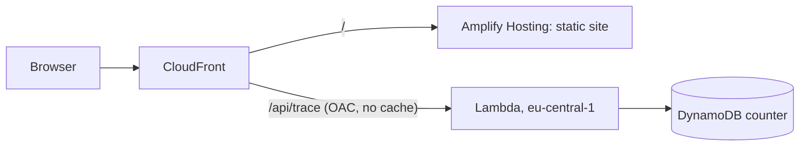

# Trace portfolio

Personal portfolio of Davide Mibelli, built for the AWS Student Builder Challenge. Its creative feature is a trace of
the visitor's own request through AWS: one tap, and the page shows the real edge location, the Lambda region, whether
the function was cold or warm, the time measured in the handler and in the browser, and a visit counter. The trace can
be downloaded as a receipt.

## How it works



- The static site is served by AWS Amplify Hosting (manual deployment of the built files).
- One CloudFront distribution fronts both the site and `/api/*`, so the call is same-origin and the browser can read the
  `x-amz-cf-pop` response header that names the edge location.
- `/api/*` uses the managed CachingDisabled policy: every trace is a fresh request.
- The Lambda function URL uses AWS_IAM auth, reachable only through CloudFront (origin access control).
- DynamoDB stores one item: an anonymous counter. The visitor's IP address is not read or stored.

## Checks you can repeat

- Run `curl -si https://d1i0z8z1jgpheg.cloudfront.net/api/trace | head -n 20` and read `x-amz-cf-pop` and the JSON yourself.
- Lighthouse on the live site, 2026-11-05: performance, accessibility, best practices and SEO all 100, on the desktop and the mobile preset.
- Cold start, 10 forced cold starts (a configuration change before each call): 255 to 297 ms in the handler, median 272 ms. The first version, with the DynamoDB client created inside the handler, took 2.2 s.

## What is measured and what is not

| Field | Source |
|-------|--------|
| Edge location | `x-amz-cf-pop` response header added by CloudFront |
| Round trip | timed in the browser with `performance.now()` |
| Handler time | timed inside the Lambda function (excludes initialisation and network) |
| Cold or warm | module-level flag in the function |
| Visit number | atomic DynamoDB `ADD` |
| City next to the edge code | airport code looked up in a static table; the raw code is shown if it is not in the table |
| Hop order in the diagram | illustrative |
| Text under each hop | written by me, not measured |

If the live call fails, the page says so and shows nothing, rather than a made-up trace.

## Develop

```sh
make install
make lint test
cd web && TRACE_API=https://<your-distribution>.cloudfront.net npm run dev   # proxies /api to a deployed stack
```

## Deploy

```sh
AWS_REGION=eu-central-1 ./infra/deploy.sh
```

Deploys the CloudFormation stack, the Lambda code and the site, then invalidates the distribution.

## Licence

MIT, see [LICENSE](LICENSE).
